# 📊 Análise de Dados — Global Superstore

Projeto de análise de dados utilizando **Python**, **Pandas** e **Matplotlib** com foco em:
- análise exploratória
- KPIs de negócio
- visualização de dados
- organização de projeto em arquitetura modular

---

# 🚀 Objetivo do Projeto

Realizar uma análise completa do dataset **Global Superstore**, extraindo insights sobre:
- faturamento
- lucro
- margem
- segmentos
- categorias
- sazonalidade
- impacto de descontos
- ticket médio
- regiões mais lucrativas

---

# 🛠️ Tecnologias Utilizadas

- Python
- Pandas
- Matplotlib

---

# 📂 Estrutura do Projeto

```bash
Projeto-Global-Superstore/
│
├── data/
│   └── raw/
│       └── Global Superstore.xls
│
├── images/
│
├── src/
│   ├── extract.py
│   ├── transform.py
│   ├── analysis.py
│   └── visualization.py
│
├── _main.py
├── requirements.txt
└── README.md
```

---

# 🔄 Fluxo do Projeto

```text
Extração → Transformação → Análise → Visualização
```

- `extract.py`
  - leitura dos dados

- `transform.py`
  - tratamento
  - criação de colunas
  - preparação dos dados

- `analysis.py`
  - cálculo das KPIs

- `visualization.py`
  - geração dos gráficos

- `_main.py`
  - controle do fluxo do projeto

---

# 📈 KPIs Desenvolvidas

- Faturamento por mês
- Lucro por mês
- Segmentos que mais faturam
- Segmentos que mais lucram
- Categorias que mais faturam
- Categorias que mais lucram
- Subcategorias que mais faturam
- Subcategorias que mais lucram
- Relação entre desconto e lucro
- Margem de lucro por categoria
- Ticket médio por pedido
- Regiões mais lucrativas

---

# 📊 Visualizações

## Faturamento por Mês

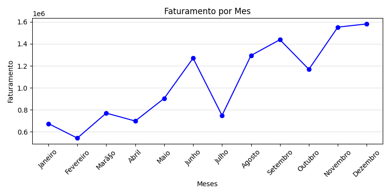

---

## Lucro por Mês

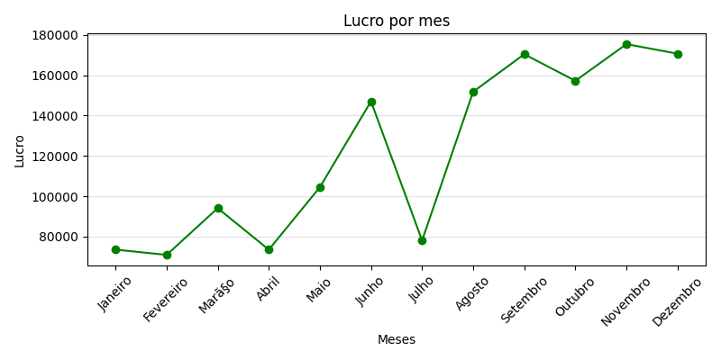

---

## Segmentos que Mais Faturam

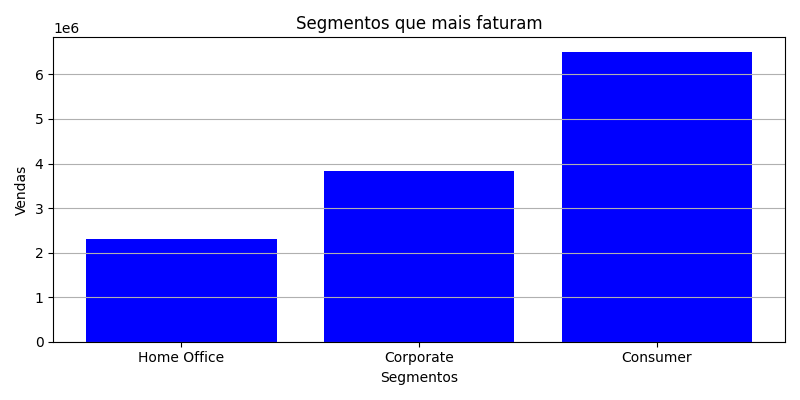

---

## Segmentos que Mais Lucram

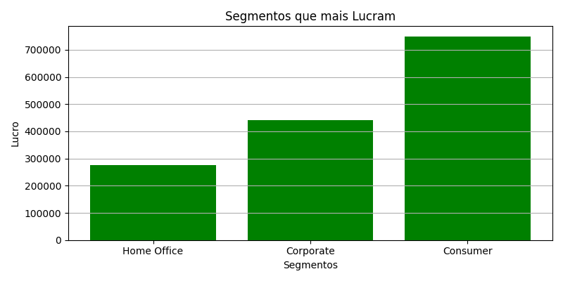

---

## Categorias que Mais Faturam

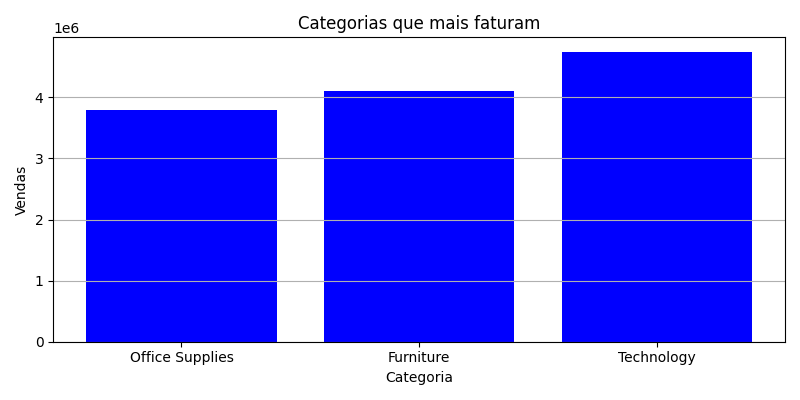

---

## Categorias que Mais Lucram

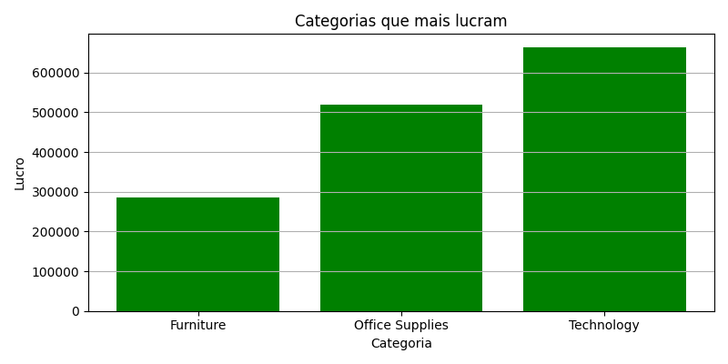

---

## Subcategorias que Mais Faturam

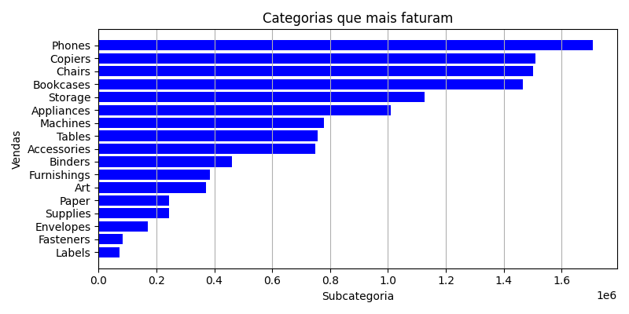

---

## Subcategorias que Mais Lucram

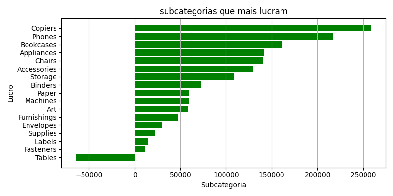

---

## Relação Entre Desconto e Lucro

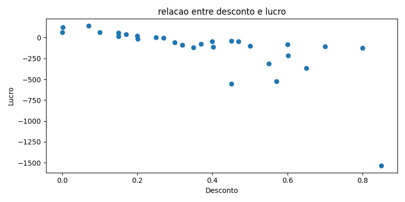

---

## Margem de Lucro por Categoria

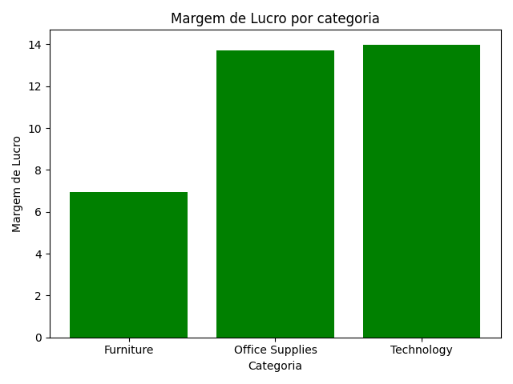

---

## Regiões Mais Lucrativas

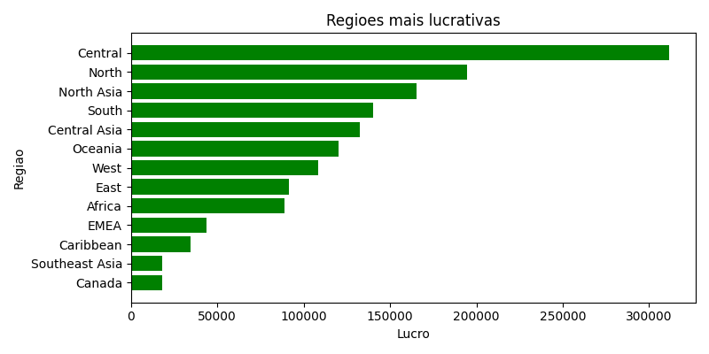

---

# 🧠 Principais Insights

- O mês com maior faturamento é dezembro, enquanto fevereiro apresenta o menor faturamento.
- Novembro foi o mês mais lucrativo.
- O segmento Consumer lidera tanto em faturamento quanto em lucro.
- A categoria Technology apresenta o maior faturamento e lucro.
- A subcategoria Phones é a que mais fatura.
- A subcategoria Copiers é a mais lucrativa.
- Descontos acima de 20% apresentam tendência de redução do lucro médio.
- Technology e Office Supplies possuem margens superiores à categoria Furniture.
- O ticket médio por pedido é de aproximadamente 504.99.
- A região Central é a mais lucrativa do dataset.

---

# 📌 Aprendizados no Projeto

Durante o desenvolvimento deste projeto foram praticados conceitos importantes como:

- análise exploratória de dados
- granularidade
- KPIs de negócio
- groupby e agregações
- visualização de dados
- modularização de código
- arquitetura de projetos em Python
- separação de responsabilidades

---

# ▶️ Como Executar

Clone o repositório:

```bash
git clone git@github.com:GabrielRicardoA/-An-lise-de-Dados-Global-Superstore.git
```

Instale as dependências:

```bash
pip install -r requirements.txt
```

Execute:

```bash
python _main.py
```